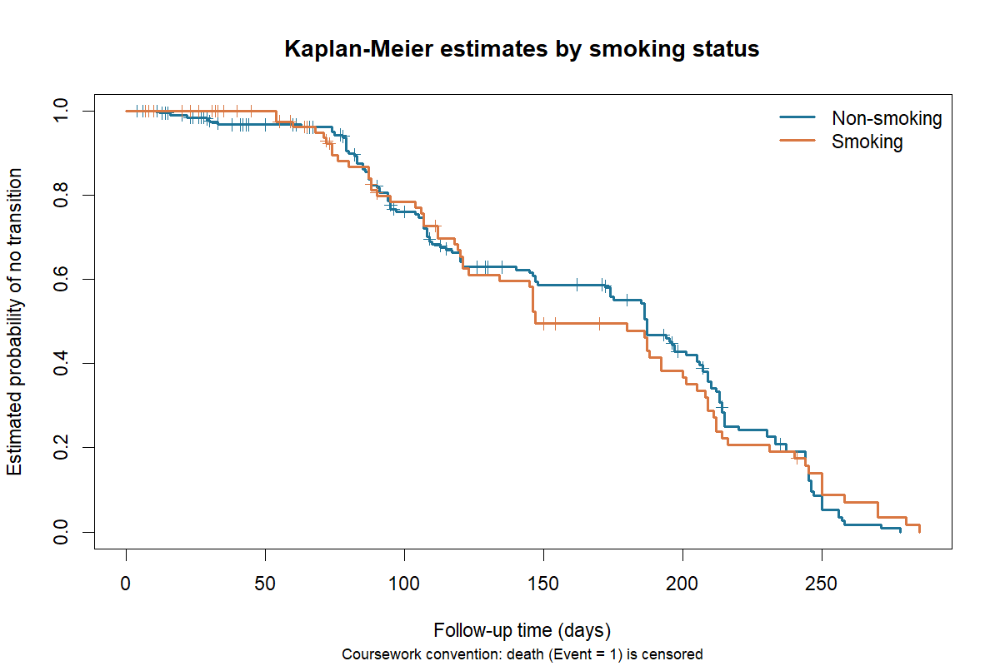
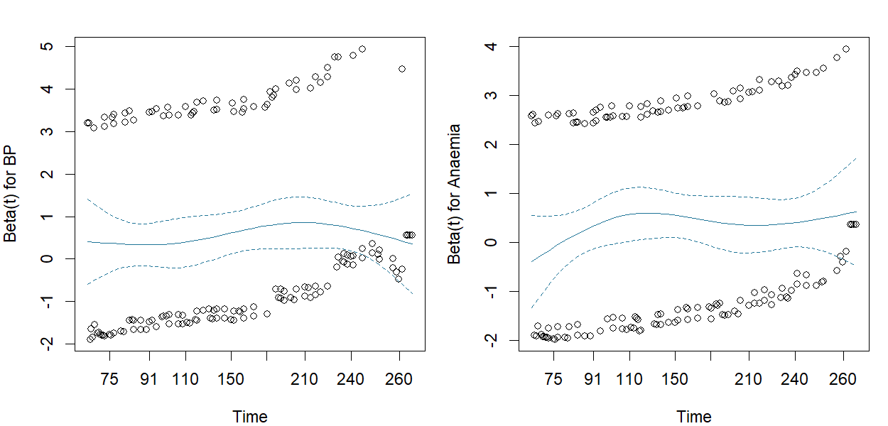
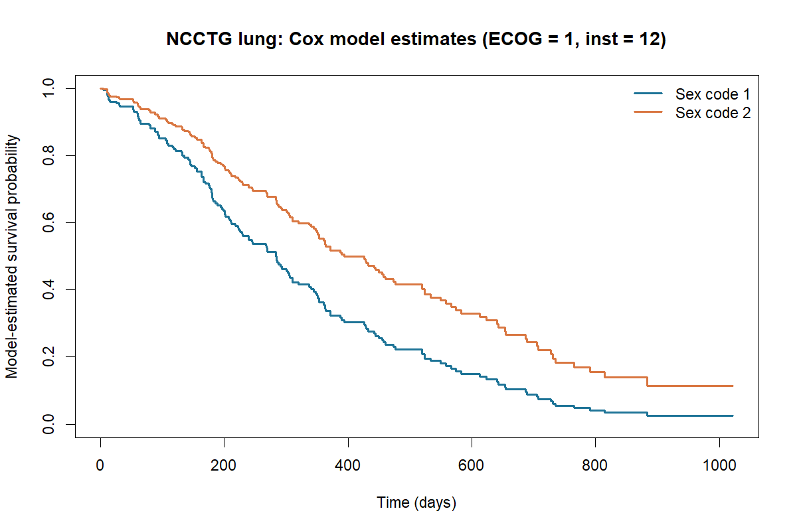
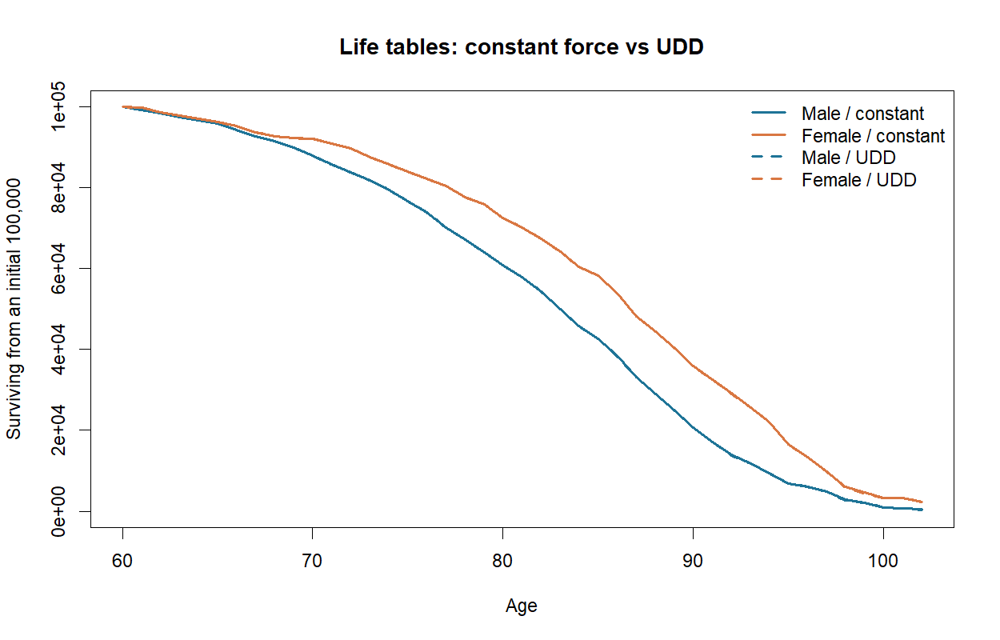
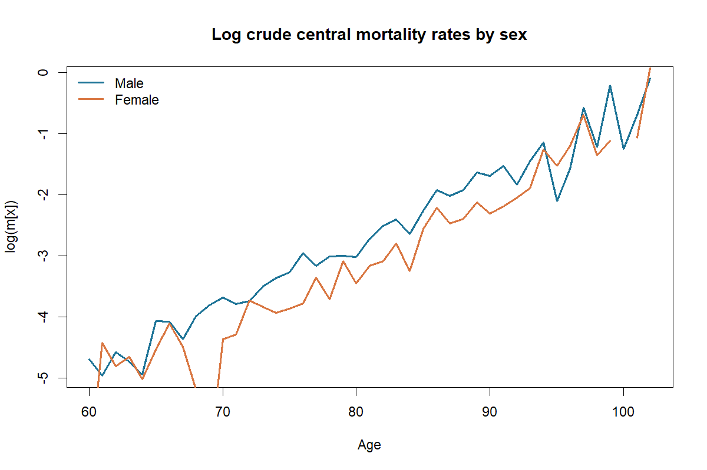

# Survival Analysis and Mortality Modelling in R

An applied statistics project developed from undergraduate MATH3085 coursework at the University of Southampton, covering **Kaplan–Meier estimation, Cox proportional hazards models, Weibull accelerated failure-time (AFT) models, and actuarial life tables**.

**Language:** R  
**Main tools:** `survival`, base R graphics  
**Project type:** Reorganised educational analysis / statistical modelling portfolio

## Research questions

| Component | Data | Statistical methods |
| --- | --- | --- |
| 1. Heart cohort | 299 anonymised patient records supplied for coursework | Kaplan–Meier curves, Greenwood confidence intervals, multivariable Cox PH, Schoenfeld diagnostics |
| 2. Lung cancer | Built-in `survival::lung` dataset | Cox regression, tied-event handling (exact vs Efron), Weibull AFT |
| 3. Pension mortality | Coursework pension-scheme deaths and exposures, ages 60–102 | Crude central mortality rates, constant-force and UDD annual death probabilities, life tables |

## Key findings from the original submitted coursework

- Under the **coursework-specific** heart event convention (deaths treated as censored), estimated 100-day probabilities of *no observed transition* were **0.7842** for smokers and **0.7606** for non-smokers. The estimates alone do not establish whether groups differ significantly.
- In the reduced heart Cox model for the defined **transition** event, the reported hazard ratios were approximately **1.746** (BP) and **1.435** (Anaemia). The original Schoenfeld global diagnostic had `p ≈ 0.40`.
- The lung workflow compared exact and Efron Cox partial likelihoods for tied event times and retained `sex` and `ph.ecog` in its selected Weibull AFT model.
- For actuarial life tables, survival counts start at `l_60 = 100,000` and are computed under both constant-force and uniform-distribution-of-deaths assumptions.

**Interpretation warning:** The original heart assignment specifies a *non-standard event encoding*: `Event == 0` is treated as an observed transition and `Event == 1` (death) as censoring. Accordingly, **the heart hazard ratios do not describe a hazard of death**. See [methodological notes](docs/methodological_notes.md).

## Results and visualisations

The five plots below were generated by running the R scripts in RStudio. The original heart-patient and pension-scheme coursework data are **not distributed** in this repository.

### 1. Heart cohort: Kaplan–Meier curves by smoking status



The curves show the estimated probability of **no observed transition** for smoking and non-smoking groups. Under the coursework-specific encoding, death is treated as censoring, **not as the event**. At 100 days, the estimates are approximately **0.7842 for smokers** and **0.7606 for non-smokers**. These curves alone do not establish a statistically significant difference, and they must not be interpreted as standard mortality survival curves.

### 2. Heart cohort: Schoenfeld diagnostics



The diagnostic plots assess the proportional hazards assumption for **BP** and **Anaemia** in the final Cox model. The global Schoenfeld test gives **p ≈ 0.399**, indicating no strong evidence against proportional hazards for this fit, although it does not prove that the assumption holds exactly.

### 3. Lung cancer: Cox model-estimated survival curves



The curves are estimated from the built-in `survival::lung` dataset using a fitted Cox model. They compare **sex codes 1 and 2**, holding the **ECOG performance score at 1** and the **institution code at 12**. The plotted differences are model-based associations, not causal effects.

### 4. Pension scheme: life tables under two mortality assumptions



Starting from **100,000 survivors at age 60**, the chart compares estimated life-table counts under **constant force of mortality** and **uniform distribution of deaths (UDD)**. The two assumptions produce closely overlapping curves at this scale. In these coursework data, female estimated survivor counts are generally above male counts at later ages; these are modelled counts, not observed survivors or population-wide estimates.

### 5. Pension scheme: log crude central mortality rates



The plot compares age-specific **log crude central mortality rates** for male and female pension members, with `m_x = deaths_x / central exposure_x`. Rates generally increase with age but fluctuate, especially at the oldest ages. Rates equal to zero cannot be shown on a logarithmic scale.

## Repository layout

```text
.
├── R/
│   ├── 01_heart_survival.R
│   ├── 02_lung_survival.R
│   ├── 03_mortality_life_tables.R
│   └── run_all.R
├── data/                 # Inputs documented but not redistributed
├── figures/              # Five selected model and mortality charts
├── results/              # Locally generated, review before publication
├── docs/methodological_notes.md
├── tests/basic_checks.R
├── .gitignore
└── README.md
```

## How to reproduce

1. Install **R** and optionally **RStudio**.
2. In R, install the only required non-base dependency: `install.packages("survival")`.
3. Put your authorised copies of the two input files in the `data/` folder as `heart.csv` and `mortality.csv`. Do **not** upload those files to a public repository before checking redistribution rights. Their expected columns and naming are described in [data/README.md](data/README.md).
4. Set your R/RStudio working directory to the repository root (the directory containing this `README.md`). Run:

```r
source("tests/basic_checks.R")   # basic formula tests; no CSV input needed
source("R/run_all.R")            # all 3 components; requires both local CSVs
```

The second component is independently runnable without private inputs:

```r
source("R/02_lung_survival.R")
```

When run, the scripts create `.csv` result tables under `results/` and `.png` figures under `figures/`. Five selected charts are intended for inclusion in the public portfolio; other locally generated outputs are excluded by default in Git until reviewed.

## Data availability and licensing

- **Heart and pension-scheme files:** from university coursework; their permission to redistribute has not been verified, so the original CSVs are **not included** here. Medical records are especially unsuitable for casual re-uploading.
- **Lung dataset:** bundled with the publicly available R `survival` package (`survival::lung`).
- **Coursework report and assessment questions:** not republished; the report contained student-identifying information and the brief belongs to the university.

## Limitations

This is a demonstration of statistical workflows, **not** a clinical prognostic tool. The heart censoring convention is assignment-specific; causal conclusions are not supported by observational model associations. The scripts were reorganised after the original coursework. The project owner has successfully run the basic checks and all three R analysis scripts through `R/run_all.R` in RStudio on Windows; independent full reproduction still requires authorised copies of the heart and pension input CSVs.
